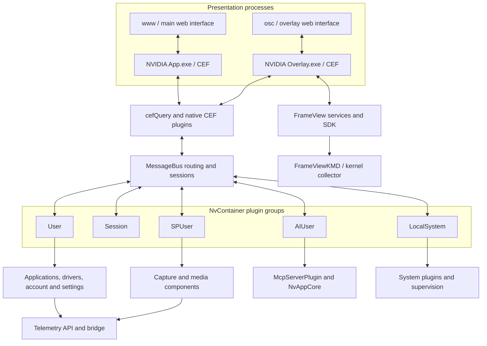
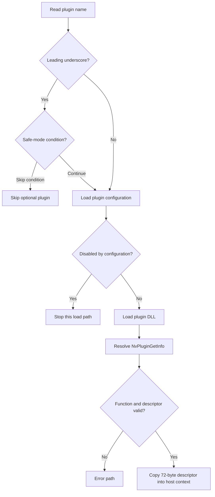
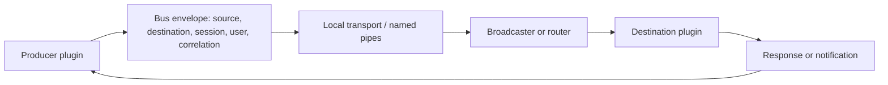
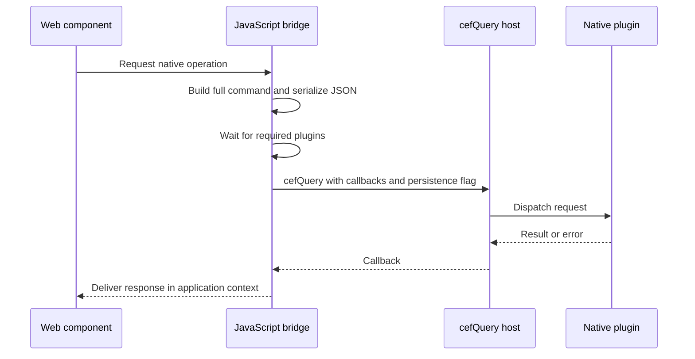
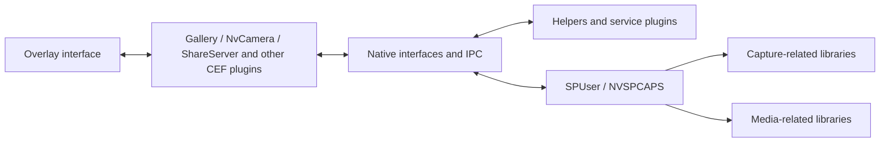
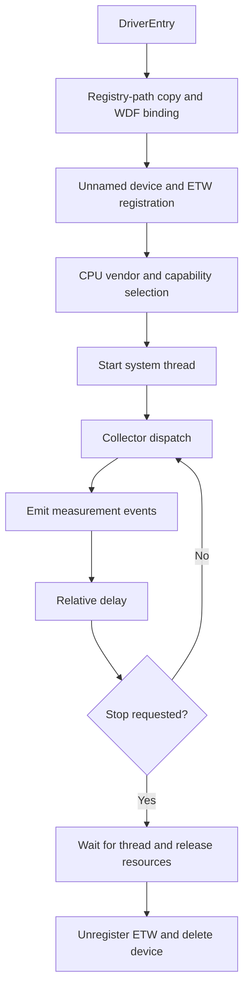
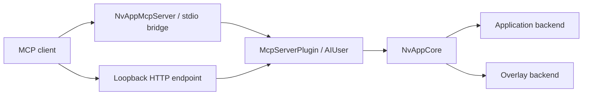
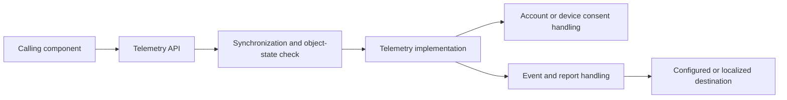
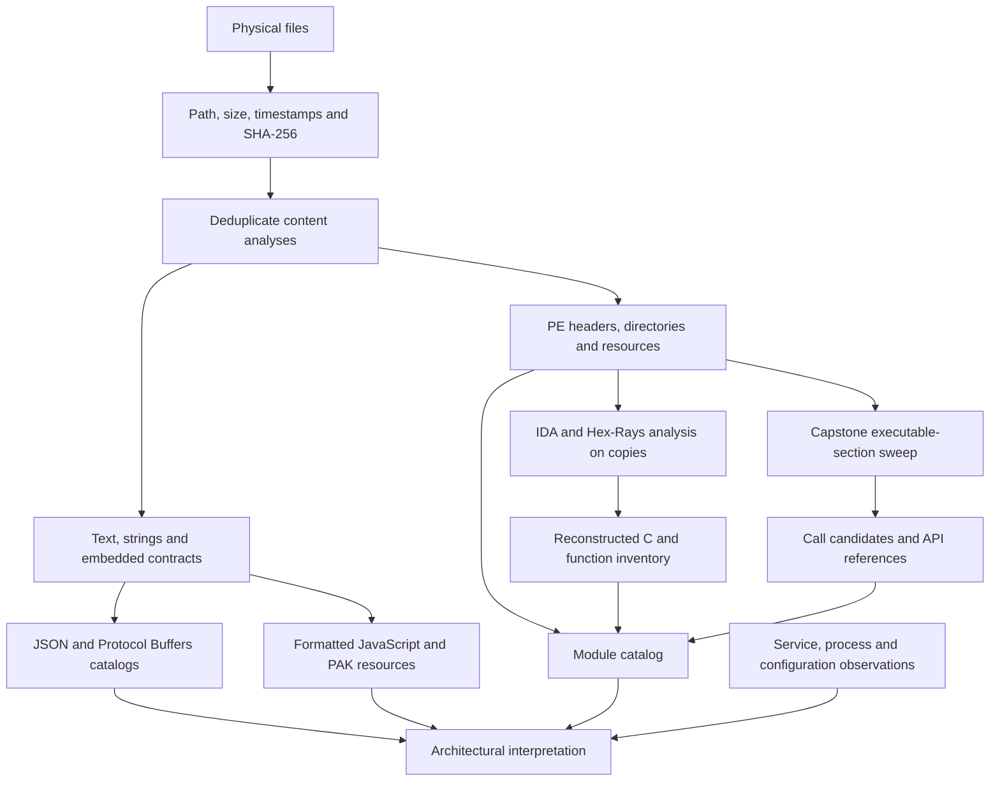

# NVIDIA software reverse engineering

A static-analysis corpus and architectural study of `C:\Program Files\NVIDIA Corporation`, captured on **11 November 2026**. The installation contains NVIDIA App **11.0.9.585**, NvContainer, FrameView SDK, telemetry components, installer packages, native plugins and Chromium-based interfaces.

The repository connects installation paths and SHA-256 identities to PE metadata, disassembly, reconstructed C, function inventories, extracted strings, JavaScript, native interfaces and Protocol Buffers descriptors. It also records selected service, process, module and configuration observations from the original machine.

**1,065 files were inventoried, 131 distinct PE images were analyzed, and 1,180,302 functions were successfully decompiled automatically.** Three modules remain partial. The reconstructed C is decompiler output, not NVIDIA's original source, and the collection is not a compilable replacement for the installed software.

[Module catalog](docs/modules.md) · [Protocol catalog](docs/protocols.md) · [Coverage data](evidence/coverage_final.json) · [Data dictionary](docs/data-dictionary.md) · [Provenance](NOTICE.md)

## Contents

- [Scope and evidence](#scope-and-evidence)
- [Coverage](#coverage)
- [Getting the corpus](#getting-the-corpus)
- [Repository layout](#repository-layout)
- [Reading addresses and identities](#reading-addresses-and-identities)
- [System architecture](#system-architecture)
- [NvContainer and plugin loading](#nvcontainer-and-plugin-loading)
- [MessageBus and recovered protocols](#messagebus-and-recovered-protocols)
- [CEF and JavaScript interfaces](#cef-and-javascript-interfaces)
- [Application, driver and settings backends](#application-driver-and-settings-backends)
- [Capture, overlay and media components](#capture-overlay-and-media-components)
- [FrameView SDK and kernel collector](#frameview-sdk-and-kernel-collector)
- [MCP server and embedded tools](#mcp-server-and-embedded-tools)
- [Telemetry, accounts and endpoints](#telemetry-accounts-and-endpoints)
- [Installer packages and persistence](#installer-packages-and-persistence)
- [Signatures, permissions and PE properties](#signatures-permissions-and-pe-properties)
- [Analysis method](#analysis-method)
- [Working with the evidence](#working-with-the-evidence)
- [Limits and unresolved questions](#limits-and-unresolved-questions)

## Scope and evidence

The static boundary is the physical file tree beneath `C:\Program Files\NVIDIA Corporation`. Junctions and symbolic links are inventoried separately. Files with identical SHA-256 values share a content analysis, while their individual installation paths remain in the inventory.

The system observations establish context outside that directory. For example, the active display driver `nvlddmkm.sys` and `NVDisplay.Container.exe` were associated with Windows DriverStore locations. Their presence in runtime observations does **not** mean their external binaries were included in this disassembly corpus.

The following distinctions apply throughout the documentation:

| Evidence class | What it establishes | What it does not establish |
| --- | --- | --- |
| File evidence | Bytes, hashes, headers, embedded strings, configuration and resources observed in the snapshot | That a distributed setting was enabled or used |
| Code reconstruction | Instructions and inferred control flow in the analyzed image | Original source types, author intent or every runtime path |
| Runtime observation | A process, service, module, registration or setting visible at a particular time | An exhaustive history or an atomic snapshot of the whole system |
| Architectural interpretation | A relationship supported by code, configuration and observed loading | A captured exchange of messages or a tested public API contract |

The original collection read installed files and produced analysis databases from copies. It did not launch the analyzed executables, install drivers, change services, invoke the embedded MCP tools or apply GPU profiles. Existing IDA databases in the installation were inventoried but were not imported as analysis inputs.

Personal account caches, recordings, general ProgramData logs, firmware and GPU microcode were outside the systematic collection. This repository contains the general software study; it does not contain a capture-backend patcher or a runtime modification utility.

Source evidence: [inventory](evidence/inventory.json), [reparse points](evidence/reparse_points.json), [analysis environment](evidence/analysis_environment.json), [runtime processes](evidence/processes.json), [loaded modules](evidence/loaded_modules.json).

## Coverage

### Installation inventory

| Measure | Result |
| --- | ---: |
| Physical file paths | 1,065 |
| Total source bytes | 910,936,825 |
| Distinct file contents by SHA-256 | 871 |
| PE file paths | 133 |
| Distinct PE images | 131 |
| AMD64 / x86 / ARM64 images | 109 / 20 / 2 |
| Imported entries | 34,239 |
| Exported entries | 9,345 |
| Exception/unwind ranges | 1,246,773 |
| Extracted native interface records | 625 |
| Distinct embedded Protocol Buffers descriptors | 14 |
| Locations containing those descriptors | 30 |
| Distinct formatted JavaScript files | 31 |

The JavaScript collection corresponds to 32 physical `.js` paths, with duplicate content sharing one formatted artifact. An exception/unwind range is not necessarily one independent source-level function. Native interface records are identified by module hash and interface name; several modules can expose related or repeated contracts.

| Installation component | Files | Bytes | PE paths |
| --- | ---: | ---: | ---: |
| NVIDIA App | 547 | 791,533,828 | 84 |
| Installer2 | 473 | 72,315,677 | 25 |
| FrameViewSDK | 36 | 27,028,824 | 18 |
| NvTelemetry | 4 | 13,464,522 | 3 |
| NvContainer | 4 | 6,486,619 | 3 |
| Root third-party license document | 1 | 107,355 | 0 |

`vGPU Licensing` existed but contained no files in this inventory. Component PE counts count paths; deduplicating those paths yields 131 images.

### Automated decompilation

| Measure | Result |
| --- | ---: |
| Reported discovered entries across final module records | 1,726,247 |
| Attempted entries | 1,181,538 |
| Successful reconstructions | 1,180,302 |
| Failed attempts | 1,236 |
| Completed modules without reported decompilation failures | 60 |
| Completed modules with individual failures | 68 |
| Partial modules | 3 |

“Completed” means the analysis pass completed under its stated accounting rules. It does not mean all possible functions were found, every type is correct or every routine was manually examined. IDA can split, merge or discover functions as analysis progresses. The final records combine attempted entries and the currently recognized function set; they should not be treated as a stable source-code function count.

| Partial module | Discovered | Attempted | Decompiled | Failures | Remaining limitation |
| --- | ---: | ---: | ---: | ---: | --- |
| `Installer2\InstallerCore\NVI2.DLL` | 22,859 | 22,859 | 22,413 | 446 | Autoanalysis queues were not exhausted; more functions may remain unidentified |
| `NVIDIA App\CEF\dxcompiler.dll` | 48,896 | 26,238 | 26,229 | 9 | Bounded continuation did not attempt all identified functions |
| `NVIDIA App\CEF\libcef.dll` | 533,816 | 11,765 | 11,758 | 7 | Both autoanalysis and pseudocode generation were bounded |

Capstone swept all on-disk bytes of executable sections for all 131 PE images. This provides broader byte coverage than the decompilation, but a linear sweep can decode padding and data as instructions. It does not establish reachability or correctness of function boundaries.

Sources: [summary](evidence/summary.json), [component totals](evidence/component_totals.json), [decompilation coverage](evidence/coverage_final.json), [disassembly index](evidence/disassembly_index.json), [native interfaces](evidence/native_interface_catalog.json), [JavaScript index](evidence/js_index.json).

## Getting the corpus

The large artifacts use **Git LFS**. Install Git and Git LFS, then clone with:

```sh
git lfs install
git clone https://github.com/dekus/nvidia-reverse.git
cd nvidia-reverse
git lfs pull
```

A clone made with LFS downloads disabled contains small pointer files in place of the corresponding evidence. The browsing tool reports missing LFS content explicitly. A repository ZIP may also contain pointers depending on the repository's archive settings; use a Git LFS clone when the complete corpus is needed.

The corpus requires several gigabytes locally. Git's LFS object storage can occupy additional space alongside checked-out artifacts. Expanding every compressed listing requires considerably more space than reading the gzip files directly.

The storage arrangement follows GitHub's [large-file limits](https://docs.github.com/en/repositories/working-with-files/managing-large-files/about-large-files-on-github) and [Git LFS model](https://docs.github.com/en/repositories/working-with-files/managing-large-files/about-git-large-file-storage). The remote's LFS storage and bandwidth allowance determines whether all content can be uploaded and downloaded there.

The optional browser is a Python standard-library script, requiring **Python 3.11 or later**:

```sh
python tools/corpus.py list FrameView
python tools/corpus.py show nvcontainer.exe
python tools/corpus.py function nvcontainer.exe --rva 0xc400
python tools/corpus.py strings nvcontainer.exe NvPluginGetInfo
python tools/corpus.py verify
```

These commands read the repository. They do not access a running NVIDIA process or modify an installed component.

## Repository layout

```text
nvidia-reverse/
  README.md
  NOTICE.md
  THIRD_PARTY_NOTICES.txt
  SHA256SUMS.txt
  docs/
    modules.md
    modules/<source-sha256>.md
    protocols.md
    protocols/<descriptor-sha256>.md
    routines/<source-sha256>-<rva>.c
    data-dictionary.md
  evidence/
    inventory.json
    pe_index.json
    coverage_final.json
    pe/<source-sha256>.json
    disassembly/<source-sha256>.asm.gz
    disassembly/<source-sha256>.summary.json
    decompiled/<source-sha256>.pseudocode.c.gz
    decompiled/<source-sha256>.spans.jsonl.gz
    decompiled/<source-sha256>.summary.json
    decompiled/<source-sha256>.ida.asm.gz
    functions/<source-sha256>.calls.jsonl.gz
    api_xrefs/<source-sha256>.json
    strings/<source-sha256>.jsonl.gz
    strings/<source-sha256>.interesting.json
    embedded_json/
    protobuf/
    js/
    text/
    ...
  tools/
    corpus.py
```

The [data dictionary](docs/data-dictionary.md) describes the remaining catalogs and their joins. Generated C and assembly comments have been removed. Function addresses remain available in the function inventories and line-span indexes. JavaScript comments are removed with an ECMAScript parser while retaining line positions and checking that the syntax tree is unchanged. Distributed license and copyright texts remain available through the notice index.

Machine-specific paths, machine SIDs, installation task identifiers and recognized credential values are redacted. The result is a transformed research corpus, not a byte-for-byte copy of every original text file. The original executable images, analysis databases, worker logs and local orchestration scripts are not included.

## Reading addresses and identities

Three different identifiers appear in the evidence:

| Identifier | Meaning | Example use |
| --- | --- | --- |
| Installation path | Position of a physical source file relative to the captured directory | Distinguish a package-cache copy from an active application copy |
| Source SHA-256 | Digest of the original file analyzed | Join PE, assembly, function and string records |
| Artifact SHA-256 | Digest of a published generated file | Verify the repository contents using `SHA256SUMS.txt` |

A file named `<hash>.pseudocode.c.gz` is named after its **source image**, not after the compressed C text. The raw `.descriptor.pb` filenames instead identify the extracted descriptor bytes themselves.

Addresses also have distinct meanings:

```text
preferred VA = preferred ImageBase + RVA
runtime VA   = actual loaded module base + RVA
file offset  = section PointerToRawData + (RVA - section VirtualAddress)
```

The file-offset formula applies within bytes actually backed by that section's raw data. It must not be applied blindly to virtual-only tails, headers or directories with special addressing rules. ASLR can change the runtime base. The corpus uses preferred addresses from the image and analysis database; it does not provide current process addresses. See Microsoft's [PE format reference](https://learn.microsoft.com/en-us/windows/win32/debug/pe-format).

Every RVA discussed below is tied to the exact source hash in the corresponding module page. RVAs, instruction sequences, class layouts and private contracts can change between releases.

## System architecture



These arrows summarize relationships reconstructed from configuration, native code and loaded-module observations. They are not a trace of a particular recording or UI action. A static import graph cannot represent the whole architecture because plugins can be loaded dynamically and components communicate through messages.

The main application and overlay each host local web content in CEF. Native plugins supply operations outside the ordinary web runtime, including application discovery, driver installation, display settings, capture and system information. NvContainer provides hosts for several plugin groups operating in different system and user contexts. FrameView has additional containers and services of its own.

Installer2 is a package cache and installation framework rather than the primary UI runtime. Telemetry API and bridge modules are shared across multiple components. Large third-party libraries account for substantial storage: `libcef.dll`, for example, contains a browser engine, while the much smaller `FrameViewKMD.sys` has a distinct kernel-mode role.

Sources: [dependency edges](evidence/dependency_edges.json), [plugin entry points](evidence/plugin_entrypoints.json), [services](evidence/services.json), [loaded modules](evidence/loaded_modules.json).

## NvContainer and plugin loading

### Host organization

The observed service command for `NvContainerLocalSystem` identifies the host, service name, logging destination and plugin directory. It includes `-s NvContainerLocalSystem`, `-d ...\plugins\LocalSystem`, `-p 30000` and `-ert`. These are recorded arguments; their undocumented meanings are not inferred from spelling alone.

Eleven reparse points were recorded in the directory tree. They connect plugin groups to component directories without creating independent copies of their content.

| Group | Configuration or observed role | Representative evidence |
| --- | --- | --- |
| LocalSystem | System-side plugins | NvCpl, NvTelemetry, ShadowPlay and Watchdog directory associations |
| Session | Session-specific components | Plugin directory configuration |
| User | Application and account backends | `NvBackend64.dll`, account, notifications, diagnostics, downloader, driver recommendations, overlay proxy and key-value storage |
| SPUser | Capture-related user components | `_nvspcaps64.dll`, IPC and backend/telemetry APIs in the observed process |
| AIUser | MCP and application integration | `McpServerPlugin.dll`, `NvAppCore.dll`, `CrimsonUtil.dll`, `NvMessageBus.dll` |

An installed plugin absent from one accessible process snapshot may be inactive, loaded elsewhere or activated only in particular circumstances. The name `Watchdog` alone does not establish every restart policy implemented by that plugin.

### Plugin descriptor loading

The `nvcontainer.exe` routine at **RVA `0xC400`** implements a concrete plugin-loading path:



The exported function name is also present at RVA `0x12E2E8`. Null function pointers, null descriptors and a zero first DWORD of the descriptor lead to error paths. The successful path copies 72 bytes. This establishes the observed descriptor transfer size; it does not by itself recover a reliable public C++ structure definition.

| RVA in `nvcontainer.exe` | Observed behavior |
| --- | --- |
| `0xC400` | Optional-plugin checks, configuration handling, DLL load, `NvPluginGetInfo` resolution and descriptor validation |
| `0x13360` | Plugin configuration construction |
| `0x13970` | Configured dependency-loading path |
| `0x13EC0` | Resource-based dependency enumeration |

At `0x13EC0`, the code opens a module with `LoadLibraryExW` using numeric flag `2`, reads string resource `0x29BB`, splits dependency names on comma, semicolon and space, checks `GetModuleHandleW`, and resolves missing modules through the configured loading path. This describes the inspected routine, not a complete search-order audit for every plugin.

The source-hash-qualified reconstructions are linked from the [NvContainer entry in the module catalog](docs/modules.md). The selected routine records are also available in [key_routines.json](evidence/key_routines.json).

## MessageBus and recovered protocols

### Routing and transport

`NVIDIA App\MessageBus\messagebus.conf` defines peers using `SystemName` and `ModuleName`, cross-session permission settings and explicit peer lists. Some cross-session entries name SID `S-1-5-18`, the LocalSystem identity. The peer list includes application and overlay routers, account services, backend components, capture and diagnostics.

The configuration value `MessageBusPort: 1` is a logical property of this configuration. It is not evidence of a TCP listener on port 1. Named-pipe strings such as `\\.\pipe\NvMessageBusBroadcast`, `PipeTransport` and `ConnectNamedPipe`, together with imports and recovered message definitions, support a local named-pipe transport interpretation.

Configured logging limits are 10 MiB for a client and 50 MiB for a broadcaster. Cleanup is configured at 604,800 seconds, with an age threshold of 172,800 seconds. These describe distributed policy, not measured log volume or guaranteed retention.



The diagram expresses the recovered contract. Session checks, peer selection and message handling must be read in their own code paths before drawing conclusions about authorization.

### Descriptor extraction

The extraction recognized 75 heuristic candidates. Thirty accepted occurrences yielded fourteen distinct `FileDescriptorProto` byte sequences; 43 other candidates were rejected. Rejection means the candidate did not satisfy the extraction and parsing rules, not that the binary was corrupt.

Each accepted descriptor has raw bytes, a descriptor digest, source module hashes, file offsets, decoded JSON and a [field-by-field catalog](docs/protocols.md). The underlying structures follow [Protocol Buffers descriptor definitions](https://github.com/protocolbuffers/protobuf/blob/main/src/google/protobuf/descriptor.proto) and the [wire encoding specification](https://protobuf.dev/programming-guides/encoding/).

| Family | Recovered content | Interpretation |
| --- | --- | --- |
| `BusMessage.proto` | Two distinct versions of the bus envelope and nested payload types | Internal routing and message representation |
| `ipc.proto` in NvCamera | 135 top-level messages | Ansel negotiation, state, dynamic UI, capture controls, progress, filters and input |
| `sdk.proto` in ShareServer | 28 top-level messages | SDK lifetime, heartbeat, language, Highlights groups, screenshots, video, permissions and overlay state |
| `battlenet_parser.proto` | `Application` and `ApplicationList` | Application discovery data used by Ontology64 |
| Collector / LightStep carrier descriptors | Span and report-related messages | Distributed tracing representation |
| Perfetto-related descriptor in CEF | Browser tracing definitions | Instrumentation shipped with the browser engine |

### BusMessage versions

The newer variant found in FrameView and NVIDIA App `NvMessageBus` components includes `protocol_version` at field `300`, `source_is_elevated` at field `301`, PID/elevation information in peer records and an `AddressCollision` status. The older variant found in `MessageBus.dll`, NvCamera and ShareServer lacks those additions.

Both variants describe identities, source and destination system/module names, session, user, correlation and generic messages. A generic message contains a numeric type and a byte payload. An encrypted-message container provides type, data and IV fields, with `NONE = 1`, `RSA = 2` and `AES = 3`. `EncryptionSetup` includes an `AESKey` field.

Those are schema fields, not recovered active keys. Their existence does not prove that every message is encrypted, nor does this comparison prove compatibility between every pair of implementations.

The heuristic does not cover descriptors that are compressed, encrypted, constructed at runtime or missed by the naming pattern. Unknown custom options may be absent from the JSON representation; the raw descriptor preserves the extracted bytes.

Sources: [descriptor index](evidence/protobuf_index.json), [embedded JSON index](evidence/embedded_json_index.json), [native interface catalog](evidence/native_interface_catalog.json).

## CEF and JavaScript interfaces

### Host configuration

`CEF\Resources\NVIDIA App.json` points the main executable to `../www/index.html` and identifies plugin directories for the background process, main application and base plugins. It also configures GPU acceleration, window behavior, the `nvidiaapp` URL scheme, update behavior and telemetry API locations.

The overlay configuration points to `../osc/index.html`, enables OSC mode and shares the storage name `NVIDIA App`. The web bundles contain Angular/RxJS structures and chunk-loading machinery consistent with a single-page application.

The principal formatted application bundle has 156,076 lines; the overlay bundle has 193,859 lines. These are generated formatting positions, not original source lines. Formatting restores indentation and statement layout without recovering minified identifiers or missing source maps. Existing source-map references are recorded in the JavaScript index.

### Native bridge

The main bundle's bridge checks for `window.cefQuery`, builds a request through `makeFullBridgeCommand`, serializes it with `JSON.stringify`, waits for required plugins, and sends the request with success and error callbacks. The `persistent` property is propagated. Response processing re-enters the Angular zone where needed.



The inspected bridge appears around lines 8,538–8,575 of the formatted main bundle. Line positions remain stable after comment removal. The [JavaScript hit indexes](evidence/js) provide additional entries for bridge calls, telemetry, settings and related strings. This sequence summarizes that code path; it does not imply that every plugin accepts requests from every origin.

Observed CEF processes included separate GPU, renderer, network, storage and audio roles. Their command lines included `--no-sandbox`; the network service also included `--service-sandbox-type=none`. These are runtime facts from the snapshot. Establishing an exploitable issue would require examining content loading, navigation, bridge origin checks and operation-specific authorization.

PAK resources were decoded structurally as Chromium DataPack files, with resource IDs, offsets, sizes, hashes and decoded text where possible. Images were inventoried by format and dimensions. V8 snapshot and ICU files were inventoried and searched for strings, without reconstructing every engine-internal structure. Individual images were not all reviewed visually.

Sources: [JavaScript index](evidence/js_index.json), [text index](evidence/text_index.json), [PAK index](evidence/pak_index.json), [image metadata](evidence/image_metadata.json), [process snapshot](evidence/processes.json).

## Application, driver and settings backends

`NvBackend64.dll` was observed in the User container together with backend APIs. `ApplicationOntology` includes `OAWrapper.exe`, `NvOAWrapperCache.exe` and `Ontology64.dll`. Their exports, names and embedded interfaces support roles in application discovery, description, optimization metadata and caching.

The plugin boundaries separate download handling, driver recommendations, diagnostics, notifications, account operations, key-value persistence and overlay communication. `NvDriverUpdateCheck64.dll` is also targeted by a scheduled task that starts NvContainer with its directory. On the CEF side, `DriverInstall.dll` connects interface operations to native installation functionality.

Product configuration identifies these service locations:

| Configuration value | Apparent role |
| --- | --- |
| `https://gfwsl.geforce.com/` | Driver-related services |
| `https://ops-gx.nvidia.com/` | Optimization services |
| `https://public.games.geforce.com/graphql` | Public application/game catalog |

These are extracted configuration values, not a record of actual connections. Requests can depend on locale, consent, login, backend availability and service responses. Game or driver names appearing in embedded response examples are examples, not evidence that those products were installed.

NvCpl contains interface, policy, resource and display components, including LocalSystem and Session plugins. `NvCpl.dll`, `nvxdbat.dll` and `nvxdplcy.dll` appeared in the observed overlay process. Overclocking-related files include `NvOc.dll`, `_OverClockingNvc.dll` and `NVIDIA App Permission.exe`. Their distribution suggests distinct UI, native-operation and permission roles; the exact permission boundary requires function-specific analysis.

`NGXWrapper.dll` and `nvngx_dlisr.dll` establish the presence of NGX/DLISR-related processing. The corpus does not reconstruct a neural network mathematically or identify the semantic purpose of every data segment. Large or high-entropy sections are not, by themselves, proof of packing or deliberate obfuscation.

Sources: [flattened product configuration](evidence/product_config_flat.json), [interface catalog](evidence/native_interface_catalog.json), [exports](evidence/export_catalog.json), [module catalog](docs/modules.md).

## Capture, overlay and media components

The capture subsystem is distributed across helpers, service plugins, a user container and CEF plugins.

| Component | Evidence-supported position |
| --- | --- |
| `nvspapi64.dll` | Native interface surface |
| `nvsphelper64.exe` and associated plugin | Coordination components |
| `_nvspserviceplugin64.dll` | LocalSystem-side plugin |
| `_nvspcaps64.dll` | Module loaded in the observed SPUser container |
| `capcore64.dll` | Capture-related core component |
| `nvmf64.dll`, `nvfcapi64.dll`, `nvfp64.dll` | Media/capture-related libraries with separate import and export surfaces |
| `nvovapi64.dll`, `nvspscreenshot64.dll` | Overlay and screenshot-related components |
| CEF Gallery, GraphicsSetting, NvCamera, Rise, ShareServer | Web-hosted UI integration and associated native interfaces |

Abbreviated filenames are not sufficient to assign a complete ABI or a precise runtime call order. The evidence includes graphics, multimedia, process and IPC imports, native JSON contracts, protocol definitions and reconstructed functions for examining those relationships.



This is a component map. It does not assert which capture backend was active in a recording, guarantee color equivalence between backends or describe a live backend switch.

Pre-existing IDA artifacts associated with `capcore64.dll` and `_nvspcaps64.dll` were present under the installation tree. They explain part of the inventory but are not DLLs loaded by Windows. Their authorship and purpose are not inferred. The decompilations published here were made from copied PE images without importing those existing databases.

## FrameView SDK and kernel collector

### User-mode SDK

FrameViewSDK contains a service, test client, x86/x64 API libraries, a public header, import libraries, PDBs, ETW components, PresentMon-related code, an aggregator and system collectors. Its distributed documentation describes per-sample and summary CSV measurements including frame time, frame rate, latency, utilization, clock rates, temperature and power.

`FvSDK.h` supplies a concrete ABI reference. Its structure-version convention combines the structure size in the low 16 bits with a version in the high 16 bits. Session handles are opaque. Data structures cover process names, FPS and averages, low/percentile metrics, latency, CPU/GPU temperature and utilization, clocks, fan speed, voltage and per-frame data.

The API includes initialization, session creation and start, metric selection and data retrieval. Use the extracted header and exports for the exact signatures and sequence; reconstructed internal class types are less reliable than this distributed declaration.

Two local PDB containers were inspected. Their GUID and age match the CodeView references in the relevant SDK DLLs. The x64 PDB also matches the copy in `bin`. A symbol match identifies the build's debugging information; it is a different comparison from a whole-file SHA-256 match.

The two `FvSDK_x64.dll` copies have matching section bytes, names and RVAs despite different whole-file hashes. This demonstrates why section-level comparison matters. It does not assign all remaining differences to the certificate table without also checking headers and other file data. The NvMessageBus and NvMessageBusBroadcast variants do not all have identical sections.

Sources: [PDB metadata](evidence/pdb_metadata.json), [binary variant comparisons](evidence/binary_variants.json), [COFF archive metadata](evidence/coff_archives.json), [text index](evidence/text_index.json).

### FrameViewKMD

`FrameViewKMD.sys` is small enough to follow a concrete initialization, collection and teardown path. All **49 identified functions** were decompiled in the initial pass. The following addresses are source-image RVAs, not current kernel addresses.

| RVA | Observed behavior |
| --- | --- |
| `0x1BE0` | `DriverEntry`: initializes the security cookie and transfers to subsequent initialization |
| `0x1C0C` | Copies the registry path, performs WDF binding and continues driver initialization |
| `0x1704` | Creates an unnamed device with a 32-byte extension, installs create/close and unload handlers, registers ETW and starts a system thread |
| `0x1590` | Uses CPUID, compares `GenuineIntel` / `AuthenticAMD`, selects a collector by vendor and capabilities |
| `0x1540` | Repeatedly dispatches the collector and waits with `KeDelayExecutionThread` until stopped |
| `0x1270` | Performs an MSR read |
| `0x1288` | Iterates over configured MSR indices and collects 64-bit values, subject to a capability flag |
| `0x12F8` | Uses `HalSetBusDataByOffset` and `HalGetBusDataByOffset` with PCI configuration offsets `0x60` and `0x64` |
| `0x13A0` | Sends event data through `EtwWriteTransfer` |
| `0x1690` | Stops collection, waits for and releases the thread, unregisters ETW and deletes the device |



The observed delay value is `-2000000` in 100-nanosecond units, a nominal **200 ms relative wait**. It does not guarantee a 5 Hz sample rate: collection time and scheduling add to that wait. The unit and sign interpretation follow Microsoft's [`KeDelayExecutionThread` documentation](https://learn.microsoft.com/en-us/windows-hardware/drivers/ddi/wdm/nf-wdm-kedelayexecutionthread).

The Intel path prepares ten MSR indices, including `0x19C`, `0x1A2`, `0x198`, `0xCE` and `0x1B1`. The AMD path uses a different set and PCI accesses. Register meaning and availability can depend on the CPU model; this study does not assign a universal meaning to every observed index.

The inspected initialization assigns `MajorFunction[0]` and `MajorFunction[2]`. It does not explicitly install a DeviceControl dispatcher in that path. Combined with the unnamed device and ETW calls, this supports a collector interpretation. It does not prove that no framework or alternate path exposes another interface.

The `FvSvc` service was stopped and configured for manual start in the snapshot. Installed FrameView libraries can still be available to other components independently of that service's observed state.

## MCP server and embedded tools

### Components and transports

The installation contains `NvAppMcpServer.exe`, `McpServerPlugin.dll` and `NvAppCore.dll`. The evidence supports a standard-input/output bridge and a local HTTP path into the AIUser plugin group.



An HTTP.sys registration observed during collection associated the MCP path with loopback port **13508**. The raw system-wide HTTP.sys dump is omitted from the public corpus; the transport observation is summarized in [runtime_observations.json](evidence/runtime_observations.json). No LAN exposure was established by this snapshot. HTTP.sys owns kernel-mode HTTP transport, so a process-filtered TCP list can be empty without disproving an HTTP registration.

Embedded strings and code include origin handling, authorization/Bearer handling, sessions, body and session limits, SSE and protocol-version handling. Their presence identifies implementation areas to examine; it does not establish that every control was exercised during collection.

### Access levels and origin checks

The original registry observation found the `NvApp` key but no `McpAccessLevel` value. The routine at **RVA `0x7C320` in `McpServerPlugin.dll`** maps stored DWORD values as follows:

| Persisted registry DWORD | Reconstructed access level |
| --- | --- |
| `1` | `readonly` |
| `3` | `full_access` |
| Missing, other value or read error | `standard` |

The implementation's internal indices `0`, `1` and `2` must not be confused with those persisted DWORD values.

The origin-checking routine at **RVA `0xF9AE0`** accepts a missing Origin header, the literal `null`, and recognized localhost/127.0.0.1 HTTP or HTTPS forms with delimiter checks. Rejected paths produce HTTP 403. This describes static control flow; the parser was not fuzzed and the behavior was not validated across all possible encodings or origins.

Sources: [registry observation](evidence/mcp_access_registry.json), [selected routines](evidence/key_routines.json).

### Embedded tool contracts

Fifteen distinct tool names were extracted from the embedded schemas: nine core/application tools and six overlay tools. Duplicate schema occurrences account for more raw records. The list is not the result of a live `tools/list` call; exposure can depend on access level, backend state and filtering.

| Tool | Contract area |
| --- | --- |
| `nvapp_echo` | Core connectivity/echo |
| `nvapp_get_gpu_info` | GPU information |
| `nvapp_client_get_applications` | Known applications |
| `nvapp_client_get_driver_status` | Driver status |
| `nvapp_client_get_driver_release_notes` | Driver release notes |
| `nvapp_client_get_laptop_features` | Laptop feature information |
| `nvapp_client_launch_application` | Launch a known application record |
| `nvapp_client_set_game_optimization` | Optimization configuration |
| `nvapp_client_set_laptop_feature` | Laptop feature configuration |
| `nvapp_overlay_echo` | Overlay connectivity/echo |
| `nvapp_overlay_get_status` | Overlay state |
| `nvapp_overlay_get_current_game_info` | Current game information |
| `nvapp_overlay_capture` | Capture operations |
| `nvapp_overlay_configure_filters` | Filter configuration |
| `nvapp_overlay_configure_stats` | Statistics configuration |

The application-launch contract refers to a known application record. It is not documented here as an arbitrary shell command or arbitrary executable-path interface. Some write-operation metadata declares a five-calls-per-minute limit; that metadata alone is not a measurement of enforcement.

Fields such as `needsConsent: false` are internal metadata and do not prove that authentication is absent. Embedded response examples are not device observations. Knowledge-base/support integration strings were present, but operational availability was not established. None of these tools was invoked during the general collection described by this repository.

Schemas: [all extracted occurrences](evidence/mcp_all_tool_schemas.json), [schema subset](evidence/mcp_tool_schemas.json), [embedded JSON](evidence/embedded_json).

## Telemetry, accounts and endpoints

### API, bridge and plugin

The telemetry stack includes `NvTelemetryAPI64.dll`, `NvTelemetryBridge64.dll` and `NvTelemetry64.dll`. API and bridge modules were visible in User and SPUser-related processes. Configuration identifies NVIDIA App version `11.0.9.585`, ProgramData work/log paths and a log limit of **25,000,000 bytes**.

The distributed configuration names `https://prod.otel.kaizen.nvidia.com/api/v2/reports`. Other entries, including `eventsUrl`, `feedbacksUrl` and `feedbackAttachmentsUrl`, use the marker `!localized`, which requires additional resolution rather than being a literal URL.

An access-token field was present and masked; its validity was not tested. The configuration sets `useNvAccountForUserConsent` to true and a refresh interval of **86,400 seconds**. These values do not reveal the user's current consent decision.

Exports cover ordinary and anonymous events, feedback, activities, experiments, user/device telemetry consent, localized endpoints and distributed tracing state. The export catalog and function reconstructions allow these operations to be examined separately instead of treating every telemetry-related name as one behavior.

### Selected consent and initialization routines

| RVA in `NvTelemetryAPI64.dll` | Finding |
| --- | --- |
| `0x110550` | `Init` and `InitializeTelemetry` share an implementation address |
| `0x110700` | `InitializeTelemetry_2` checks two non-null wide strings and dispatches to `0x10F2E0`; the invalid path raises `invalid_argument` |
| `0x111840` | `GetUserTelemetryConsent`: synchronization, global object check and virtual dispatch |
| `0x111C60` | `GetDeviceTelemetryConsent`: corresponding device-consent path |

The inspected getters dispatch through vtable offsets 64 and 80. When the global object is unavailable, the reconstructed code returns `2147947423`; the successful delegated path returns status `0`. Those status values must not be mistaken for the boolean consent value itself.



The diagram identifies code/configuration relationships. No outbound telemetry traffic was intercepted for this study. URLs found in certificate chains, OCSP/CRL data, Chromium or other third-party libraries are not automatically NVIDIA telemetry endpoints.

Account components include login/user-store configuration, local redirects and candidate ports. Personal account caches were not extracted. See the [URL catalog](evidence/urls.json), [domain catalog](evidence/domains.json), [product configuration](evidence/product_config_flat.json) and [routine records](evidence/key_routines.json) for source context.

## Installer packages and persistence

Installer2 contains core code, package extensions, cached instructions and copies of package payloads. The inspected metadata includes **19 NVI files, 19 NVX files and 4 INF files**. NVX entries are XML with an `nvi` root. An Authenticode `UnknownError` on an NVX file is not equivalent to an invalid PE signature.

Package material covers the display driver, application, backend, control panel, MessageBus, PhysX, FrameView, audio, container, watchdog, DLISR, telemetry and capture components. Values such as `${version}` are installer placeholders and must not be reported as installed version strings.

| Cached INF family | Version evidence |
| --- | --- |
| Display driver | `32.0.16.2101`, dated 2026-10-19 |
| Additional display-driver cache | `32.0.16.1088`, dated 2026-07-22 |
| HD Audio | `1.4.6.6` |
| Virtual Audio | `4.92.0.0` |

Two cached display-driver packages do not mean two display drivers were simultaneously active. ARM64 audio binaries in the package cache likewise do not establish execution on the observed x64 host.

Two scheduled tasks were recorded: a daily driver-update check that starts NvContainer with the update-check plugin directory, and an NVIDIA App self-update task that starts the application executable. Task actions, principals and trigger types are retained with installation-specific identifiers redacted. The collection did not trigger them.

Sources: [installer metadata](evidence/installer_metadata.json), [tasks](evidence/tasks.json), [trigger details](evidence/task_trigger_details.json), [services](evidence/services.json), [driver observations](evidence/drivers.json).

## Signatures, permissions and PE properties

### Authenticode and mitigation flags

All **133 PE paths** had an Authenticode status of `Valid` under the machine's trust configuration during collection. This is a time-specific Windows trust result, not an independent comparison against a fresh vendor download or proof that the program contains no defects.

| PE property | Distinct images |
| --- | ---: |
| `DynamicBase` | 131 |
| `NXCompat` | 131 |
| `HighEntropyVA` | 111 |
| `GuardCF` | 128 |
| `NoSEH` | 1 |
| `ForceIntegrity` | 4 |
| `AppContainer` | 0 |
| Sections simultaneously readable, writable and executable | 0 |

The three images lacking the recorded GuardCF flag are `amd_ags_x64.dll`, `ddETWExternal.dll` and `NvUIR.dll`. A PE flag is a property of the image, not a complete audit of runtime protections or every indirect call site.

### Filesystem permissions

The collection read **125 directory ACLs** and **133 PE-file ACLs**. The recorded broad-principal check found no Allow entries granting write, delete, modify-ACL or full-control rights to Users, Everyone or Authenticated Users in its candidate set.

This was an ACL inspection, not a complete effective-token analysis. Inheritance, group membership, deny entries, ownership, reparse resolution and external directories can affect effective access. Machine-specific SIDs have been redacted, so the public records are research data rather than SDDL that should be applied to another machine.

Sources: [signatures](evidence/signatures.json), [directory ACLs](evidence/directory_acls.json), [PE ACLs](evidence/pe_file_acls.json), [broad-write candidates](evidence/acl_broad_write_candidates.json).

### libcef unwind anomalies

The parsed exception table in `libcef.dll` contains **201 records whose end RVA is below the start RVA**. A separate raw-byte check confirmed those record values at their file offsets. Both the interpreted entries and raw bytes are retained in [unwind_anomalies.json](evidence/unwind_anomalies.json) and [unwind_independent_check.json](evidence/unwind_independent_check.json).

The observation does not establish a cause. It is not presented as evidence of tampering, an exploitable flaw or a general explanation of the browser's exception handling. It is a concrete discrepancy that matters when using those records as function boundaries.

No confirmed vulnerability is claimed by this repository. Imports such as process-memory access, hooks or networking identify available capabilities; their presence alone does not establish malicious behavior.

## Analysis method

### Evidence pipeline



### Inventory and PE extraction

Each physical file was identified by relative path, size, SHA-256, type and UTC timestamps. The inventory records whether the source remained stable during its read. Content deduplication avoids repeating work on identical bytes while preserving installation-path relationships.

PE extraction covers DOS/NT headers, sections, ordinary and delayed imports, exports, resources, manifests, version information, CodeView references, TLS callbacks, Load Config, data directories and exception records. Section entropy is descriptive and is not used as a standalone verdict about packing or encryption.

The recorded environment includes Python 3.14.4, pefile 2024.8.26, Capstone 5.0.7 and IDA/Hex-Rays version identifier `920`. The Protocol Buffers parser version is recorded separately in its index. Tool versions describe the original collection; the browsing utility only needs Python's standard library.

### Disassembly and call references

Capstone decoded raw bytes from every section marked `IMAGE_SCN_MEM_EXECUTE`, with skip-data behavior enabled. Preferred image addresses are used in the listings. Instruction counts can include data and padding that happen to decode. Sections with no executable raw bytes naturally contribute no instructions.

Recognized API references include direct calls and identifiable IAT-based references in x86/x64 listings. Register-loaded targets, virtual calls, `GetProcAddress`, generated code and other indirect mechanisms are not resolved generally. Call and API-reference records therefore have both missing relationships and possible false positives introduced by linear decoding.

### Decompilation passes

Initial attempts used bounded work intervals: normally 240 seconds of work with a 300-second process bound, or 780/900 seconds for files above 20 MB. Autoanalysis could consume part or all of that budget. These were collection limits, not claims about how long complete analysis should take.

Continuations reused saved databases and allowed up to 480 seconds for pseudocode work with a 540-second process bound. Separate recovery attempts for the initial timeouts used up to 360 seconds of incremental autoanalysis followed by a bounded pseudocode pass, with a 960-second process limit. A module remained partial when analysis queues were unfinished or not all recognized entries were attempted.

The IDA assembly artifact represents the initial function listing. It does not grow automatically to cover every continuation. Some recovery-only listings contain no function assembly. Use the Capstone listing for the complete executable-section sweep, and the final coverage record for decompilation status.

One NvTelemetry64 continuation was interrupted at its process limit. **10,407 complete pseudocode blocks** were recovered using subsequent function markers as boundaries; the last incomplete block was discarded. Fields that could not be recovered, including some function sizes, flags and xrefs, remain null. The recovered blocks were recompressed as valid gzip content.

`NVI2.DLL` received a further 90-second autoanalysis pass and decompilation of newly found entries, adding 2,377 attempts and bringing its total to 22,859. It remains partial because its autoanalysis queues were not exhausted.

### Strings, resources and frontends

String extraction recognizes printable ASCII and the same character range encoded as UTF-16LE, with a minimum length of six characters. It omits shorter strings, other character ranges, compressed data and values assembled at runtime. Full extracted strings are stored with file offsets; a smaller selection records patterns of interest.

JavaScript was formatted without renaming minified variables. PAK files were interpreted as resource containers. Text configs, installer metadata, images, COFF archives and PDB container metadata were analyzed using their corresponding formats. Raw descriptor bytes preserve Protocol Buffers information beyond the decoded JSON view.

### Publication transformations and integrity

The public corpus removes collection-machine paths and worker bookkeeping, translates coverage labels to English, redacts recognized sensitive values and removes generated code comments. Function span indexes preserve the association between a function RVA and its lines in the cleaned C stream. JavaScript hit indexes are regenerated after comment removal.

Distributed license text remains available. The public README and catalogs replace the original local report presentation. Existing source hashes remain unchanged as identifiers; generated artifact hashes are recomputed after transformation.

`SHA256SUMS.txt` covers the published files other than itself and Git metadata. Verify it with:

```sh
python tools/corpus.py verify
python tools/corpus.py verify --deep
```

The first command checks artifact digests and detects missing LFS content. The second also parses JSON/JSONL and reads gzip streams to their end, checking decompression integrity. Neither command proves the correctness of a decompiler's type inference or the truth of an architectural interpretation.

## Working with the evidence

### Follow one routine from path to code

```sh
python tools/corpus.py list nvcontainer.exe
python tools/corpus.py show nvcontainer.exe
python tools/corpus.py function nvcontainer.exe --rva 0xc400 --output plugin-loader.c
python tools/corpus.py strings nvcontainer.exe NvPluginGetInfo
```

Use the module's source hash to locate its PE record, reconstructed function inventory, assembly and API references. Compare the reconstructed call sequence with instructions before assigning reliable types to parameters or structure fields. The output C is analysis text and may require unknown typedefs, globals and synthetic identifiers; compiling it is not an integrity check.

### Inspect a protocol

Start from [the protocol catalog](docs/protocols.md), select the descriptor variant and inspect its module occurrences. Compare field numbers, types, labels and nested enums. A descriptor name alone is insufficient because several binaries can ship different bytes under the same `.proto` name.

Preserve the source module hash and file offset when reporting a finding. Prefer the raw descriptor for checking options that the JSON representation does not retain. Neither the browser nor the extraction data sends protocol messages to an installed service.

### Trace a native interface

Search `evidence/native_interface_catalog.json` for the operation name. Each record connects the module, source hash, extraction offset, command/notification flags, description and schema. Then inspect the corresponding module's strings, call references and reconstructed functions to locate implementation paths.

A schema is an interface description, not proof that a call is exposed, authorized or available in every runtime state. The JSON schema's declared constraints and the implementation's actual checks are separate things to verify.

### Compare a future installation

Hash the relevant files in the new installation and compare them with `inventory.json`. An equal hash means the analyzed bytes match; a changed hash requires new evidence. File versions and timestamps are useful context but do not replace content comparison.

For changed binaries, re-extract PE structure and embedded interfaces, compare sections and exports, and repeat disassembly and decompilation for the relevant paths. Compare PDB GUID/age only when matching debug information is present. The existing corpus does not adapt itself to new code or guarantee that an RVA, signature or inferred layout remains valid after an update.

## Limits and unresolved questions

| Area | Current limit |
| --- | --- |
| Semantic coverage | More than a million successful automated reconstructions do not imply manual understanding of every function |
| Partial modules | CEF, the shader compiler and installer core retain explicit gaps |
| Function boundaries | Exception records, linear decoding and evolving IDA analysis can disagree |
| Types and object layouts | Decompiler guesses require confirmation in calling code and instructions |
| Dynamic behavior | No complete event trace, message capture or systematic operation-by-operation exercise was performed |
| Network use | Configured endpoints and embedded URLs do not establish observed traffic |
| Permissions | ACL and origin-check observations are narrower than a complete authorization audit |
| Protocol extraction | Compressed, encrypted or runtime-generated schemas can be missed |
| Driver scope | DriverStore display-driver binaries, firmware and GPU microcode are outside the static root |
| Assets and models | Resource inventories do not provide complete visual review or mathematical model reconstruction |
| Release compatibility | All addresses and private-contract observations are specific to the captured source identities |

Useful follow-up work includes finishing the three partial decompilations, validating selected runtime message paths, confirming private structure layouts across callers, comparing protocol variants between releases, and investigating the cause of the confirmed CEF unwind-record anomalies. Findings should cite the source SHA-256, RVA or file offset, and the precise evidence that supports the conclusion.
