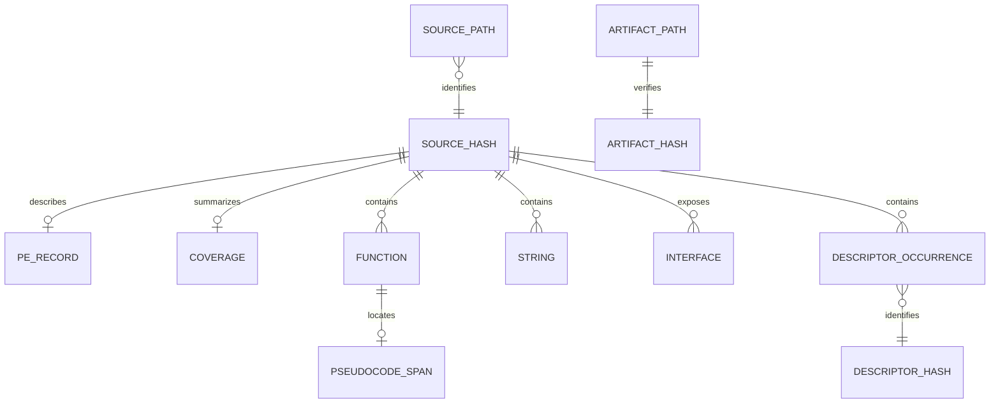

# Data dictionary

Paths in the source catalogs are relative to the captured `C:\Program Files\NVIDIA Corporation` directory unless a record explicitly describes an external runtime path. JSON files use UTF-8. JSONL files contain one object per line and are gzip-compressed where their suffix is `.gz`.

## Identity and joins

`inventory.json` is the path-level source catalog. `pe_index.json` is the distinct-PE catalog. The `sha256` field joins native analysis artifacts across directories. A single hash can correspond to multiple physical paths. Names of generated files use this source hash even though formatting, redaction and reconstruction produce different bytes.

`SHA256SUMS.txt` at the repository root instead contains the digest of each published artifact. Protocol descriptor digests identify the extracted raw descriptor, rather than the enclosing PE. Keep these three uses separate when reporting a mismatch.

## Source and coverage catalogs

| File | Unit | Important fields and interpretation |
| --- | --- | --- |
| `inventory.json` | Physical file path | `path`, `size`, `sha256`, `type`, `extension`, `mtime_utc`, `ctime_utc`, `stable_during_read` |
| `pe_index.json` | Distinct PE content | Canonical path, source digest, bitness, source size, import/export counts, unwind-range count and executable raw bytes |
| `summary.json` | Whole collection | Inventory totals, architecture counts, mitigation counts, changed-file records and extraction errors |
| `component_totals.json` | Top-level component | Physical file count, bytes and PE-path count |
| `duplicates.json` | Repeated source content | Different physical locations sharing one digest |
| `coverage_final.json` | Distinct PE content | Final state, discovered/attempted entries, successful reconstructions, failures and partial reason |
| `analysis_environment.json` | Static scan | Capture time, source boundary, tool versions and extraction settings |
| `snapshot_time.json` | System collection | Timestamp associated with the system observations |
| `publication.json` | Public export | Transformations and categories excluded from this publication |

Coverage states are `complete`, `complete_with_errors` and `partial`. A partial result can have attempted every function currently known to IDA while still having unfinished analysis queues. Counts cannot be interpreted without the state's explanation.

## Native image artifacts

For source digest `H`:

| Artifact | Content | Important limits |
| --- | --- | --- |
| `pe/H.json` | Machine type, image base, entry point, sections, imports, delayed imports, exports, resources, debug records, version data, exception ranges, mitigations, TLS, Load Config, directories and overlay metadata | Parsed image properties do not prove runtime behavior |
| `disassembly/H.asm.gz` | Capstone linear listing of executable raw sections | May decode data and padding; does not infer reachability |
| `disassembly/H.summary.json` | Section coverage, instruction/data counts, call candidates and recognizable API-reference counts | Byte coverage differs from semantic coverage |
| `decompiled/H.pseudocode.c.gz` | Reconstructed C-like text with generated comments removed | Not original source or a self-contained compilation unit |
| `decompiled/H.spans.jsonl.gz` | `va`, `rva`, `name`, `start_line`, `end_line` for each recovered C block | One-based inclusive line range in the cleaned decompressed stream |
| `decompiled/H.summary.json` | Function records, individual failures, image base, analysis state and decompiler metadata | Some recovered records have null size/flags/xrefs |
| `decompiled/H.ida.asm.gz` | Initial IDA function listing | Continuation functions are not necessarily listed; some recovery-only files are empty |
| `functions/H.calls.jsonl.gz` | Candidate call site `va`, `target`, `operand`, recognized `api` or null | Does not resolve every dynamic or virtual call |
| `api_xrefs/H.json` | Recognized API references and associated addresses | Restricted by the instruction and target-recognition method |
| `strings/H.jsonl.gz` | File `offset`, `encoding`, extracted `text` | Printable ASCII and equivalent UTF-16LE range, minimum six characters |
| `strings/H.interesting.json` | Selected string records matching analysis patterns | A filtered view, not the complete string corpus |

Some large recovered modules also have a catalog of recognized functions beyond those with pseudocode. In particular, libcef's `all_functions.jsonl.gz` contains entries that were discovered but not decompiled. A failed or unattempted function has no successful pseudocode span.

The module summaries preserve reported function names, addresses, sizes, flags, incoming xrefs and decompilation results when available. Synthetic names such as `sub_...` and inferred type annotations retain their decompiler meaning. A null field means unavailable information, not a value of zero.

Addresses in the listings are preferred VAs. Function `rva` values are relative to the source image base. String and descriptor offsets describe bytes in the source file. Character offsets in text-oriented catalogs are not interchangeable with file offsets.

## Interfaces, protocols and code selections

| File or directory | Content |
| --- | --- |
| `native_interface_catalog.json` | Module path, source hash, extraction offset, interface name, command/notification flags, description and JSON schema for 625 records |
| `embedded_json_index.json` | Modules containing accepted embedded JSON objects, object counts and root-key summaries |
| `embedded_json/` | Extracted JSON objects with provenance supplied by their records and index |
| `protobuf_index.json` | Candidate accounting, extraction method, parser version, accepted descriptor summaries and rejected candidates |
| `protobuf/D.descriptor.pb` | Raw `FileDescriptorProto` bytes identified by descriptor digest `D` |
| `protobuf/D.json` | Decoded descriptor, including messages, fields, enums, options and service declarations when present |
| `mcp_all_tool_schemas.json` | Twenty-four extracted occurrences representing fifteen distinct MCP tool names; retains module provenance |
| `mcp_tool_schemas.json` | Nine core-tool schema records with file offsets; a subset of the wider extraction |
| `key_routines.json` | Twenty-four selected routines with module, source hash, VA, RVA, function name, chapter and reconstructed C |
| `export_catalog.json` | Consolidated native export evidence |
| `plugin_entrypoints.json` | Per-module export records used to locate plugin entry points |
| `dependency_edges.json` | Static import-derived dependency relationships |

Descriptor JSON follows the parser's representation of `FileDescriptorProto`, with fields such as `message_type`, `nested_type`, `field`, `enum_type` and `oneof_decl`. Field numbers, enum numbers and type names describe the wire contract. Unknown custom options can survive in the raw descriptor without appearing in the JSON view.

## Web content, text and assets

| Artifact | Content |
| --- | --- |
| `js_index.json` | Source path/hash, formatted line count, hit count, source-map references and publication transformation |
| `js/H.js` | Formatted JavaScript; minified names retained, comments removed with a parser |
| `js/H.hits.json` | One-based formatted line number and text excerpt for matching bridge/settings/telemetry patterns |
| `text_index.json` | Source text path/hash, original character and line counts, and original extraction-redaction flag |
| `text/H.txt` | Decoded text resource; redacted and, for JavaScript, comment-cleaned for publication |
| `text/H.pak.json.gz` | Extracted PAK resource records |
| `pak_index.json` | Container version, encoding, resource/alias counts, final offset and structural checks |
| `image_metadata.json` | Image format, dimensions and related asset metadata |
| `product_config_flat.json` | Flattened product configuration values with their source context |
| `installer_metadata.json` | Installer/manifest structure, attributes and extracted operations |
| `coff_archives.json` | Archive members, linker symbols and structural metadata for import libraries |
| `pdb_metadata.json` | MSF stream metadata, GUID/age and matching CodeView references; no original PDB redistribution |
| `binary_variants.json` | Same-name source variants, section digests and relevant header/certificate metadata |
| `urls.json` | Extracted URL values with source and character-offset context |
| `domains.json` | Domain-level grouping of extracted URLs |

Line counts in the original text index describe the collected input text, not an assurance that every transformed publication has identical byte length. Redaction can change string length. JavaScript formatting-line references are preserved when comments are removed. Source-map references are strings observed in distributed content; the corresponding source maps are not assumed to exist in this repository.

The `text/` directory also contains resource-derived text and decoded package metadata beyond the primary text index. `pak_index.json` and `installer_metadata.json` provide their source context. Distributed licenses and copyright notices remain evidence and are indexed in `THIRD_PARTY_NOTICES.txt`.

## Runtime and security observations

| File | Observation |
| --- | --- |
| `processes.json` | NVIDIA-related processes, parent relationships, executable paths and command lines available to the collector |
| `loaded_modules.json` | Modules visible in inspected processes; an empty result is not proof that the process loaded no modules |
| `services.json` | Service names, startup mode, state, account, command and process association |
| `drivers.json` | Relevant driver observations, including paths outside the static root |
| `tasks.json`, `task_trigger_details.json` | Scheduled-task actions, principals, states and trigger details |
| `reparse_points.json` | Junction/link information, preventing duplicate recursive interpretation |
| `named_pipes.json` | Names observed during collection; names alone do not establish protocol behavior |
| `tcp.json`, `udp.json` | Socket observations made by the original collector, subject to its process filtering |
| `runtime_observations.json` | Public summary of the loopback HTTP.sys registration; excludes the system-wide dump |
| `mcp_access_registry.json` | Original key/value presence observation for `McpAccessLevel` |
| `signatures.json` | Windows Authenticode status, signer/certificate context and file-version information |
| `directory_acls.json`, `pe_file_acls.json` | ACL entries, owners and redacted SDDL |
| `acl_broad_write_candidates.json` | Results of the broad-principal write-rights selection |
| `windows_collection_errors.json` | Reported Windows collection errors |
| `unwind_anomalies.json` | Parsed exception records whose bounds violate the expected ordering |
| `unwind_independent_check.json` | Raw file offsets, bytes and independently decoded fields for those records |

These records were collected at different times. Process identifiers are snapshot-local; they are not stable identities across restarts. Missing or inaccessible fields remain distinct from a confirmed absence. The public records redact machine-specific identities and must not be used to restore local configuration.

## Validation

`python tools/corpus.py verify` hashes each listed artifact and detects LFS pointers in place of expected content. `--deep` additionally parses JSON/JSONL and reads compressed streams to EOF. The manifest excludes itself and `.git` metadata.

Validation checks the published package. It does not rerun disassembly, prove an architectural inference, verify an external installation's signatures or fill missing decompilation coverage. For a future source version, establish new source hashes and repeat the relevant analysis.
